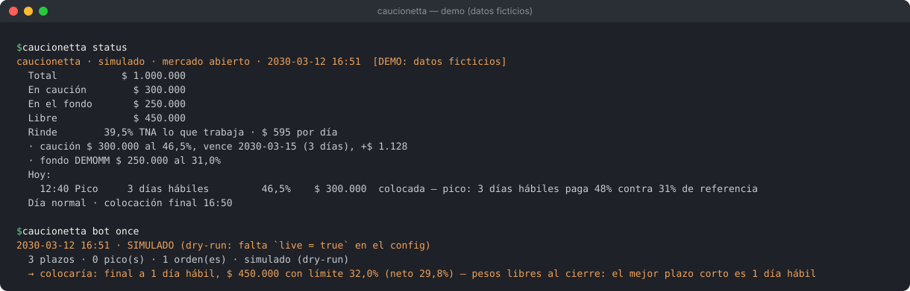
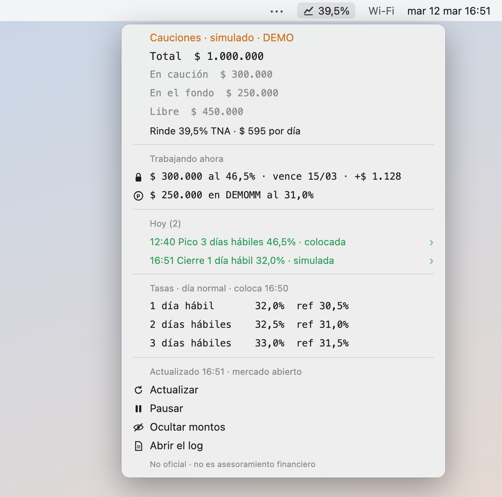
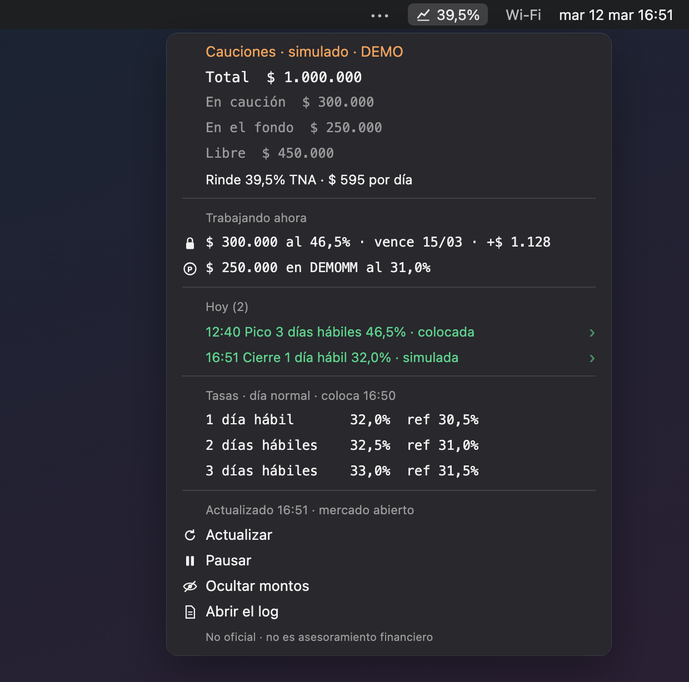
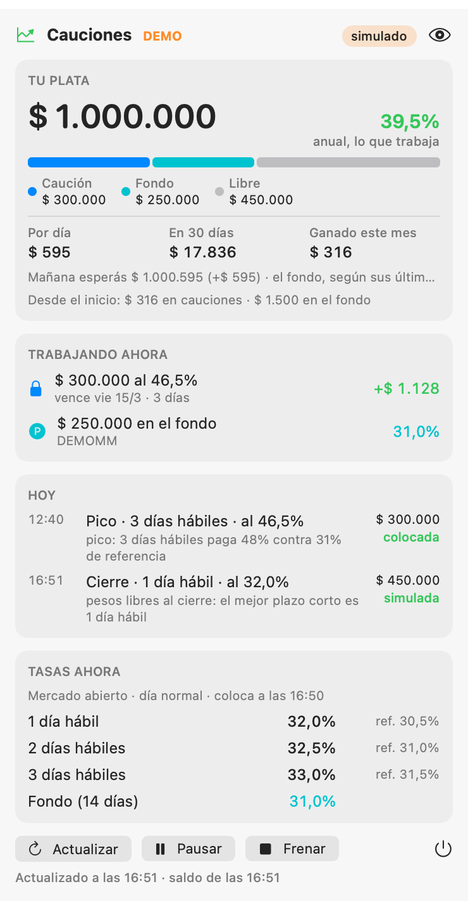
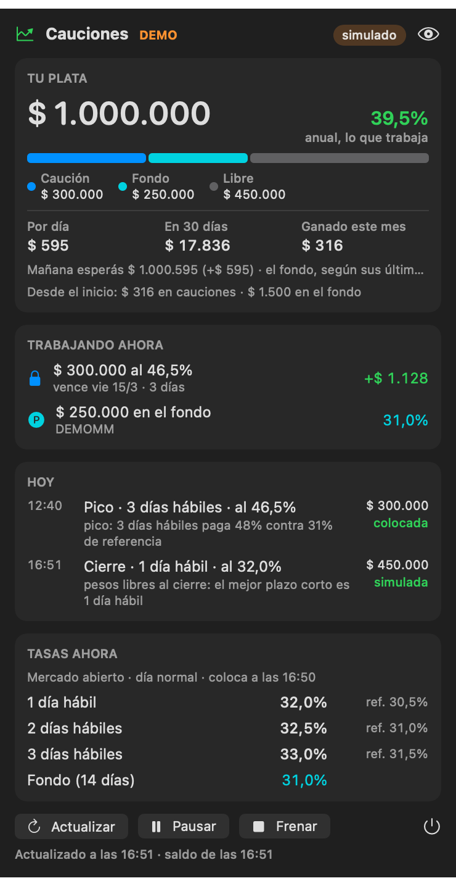

# caucionetta

**Herramientas no oficiales para operar cauciones en InvertirOnline (IOL) desde la terminal, la barra de menú de
macOS y tu agente de código.**

> **No oficial.** caucionetta no está afiliado, avalado ni soportado por InvertirOnline. "IOL" e "InvertirOnline" son
> marcas de sus dueños y se nombran sólo para decir con qué API habla esto.
>
> **No es asesoramiento financiero.** El bot manda órdenes reales sólo si vos lo habilitás dos veces, y vos sos
> responsable de cada orden que salga de tu cuenta. Probalo en modo simulado (es el default) antes de pensar en
> otra cosa.



*Todas las imágenes y ejemplos de este README salen del **modo demo**: datos inventados, sin cuenta y sin red.*

## Qué es

- **CLI** (`caucionetta`): estado de tu plata, tasas de caución por plazo hábil, el log de decisiones, un `doctor`.
  Salida para humanos por defecto y `--json` para máquinas.
- **Bot de caución colocadora** en pesos (1 a 7 días): toma picos de tasa, deja órdenes límite esperando en días
  de picos probables, y antes del cierre coloca los pesos que quedaron libres en el mejor plazo corto. Opcional:
  estacionar en un fondo money market de rescate en el día. **Corre en dry-run por defecto.**
- **Barra de menú**: un plugin para [SwiftBar](https://github.com/swiftbar/SwiftBar) y una app nativa en Swift.
  Las dos leen un archivo local: abrirlas **nunca** llama a IOL.
- **Servidor MCP** (`caucionetta mcp`) para Claude Code, Codex, Cursor, Gemini CLI o cualquier cliente MCP: lecturas
  libres y escrituras en dos pasos (propose → apply) que sólo ejecutan con tu "sí" y el modo en vivo habilitado.
- **launchd**: `caucionetta install-agent` lo programa para que corra solo cada minuto.

Python ≥ 3.11, sólo biblioteca estándar (cero dependencias en runtime). macOS para Keychain, notificaciones,
barra de menú y launchd; en Linux andan la CLI, el bot (con variables de entorno y cron/systemd) y el MCP.

## Capturas

| SwiftBar (claro) | SwiftBar (oscuro) |
|---|---|
|  |  |

| App nativa (clara) | App nativa (oscura) |
|---|---|
|  |  |

Las de SwiftBar son un render fiel de la salida real del plugin (`docs/img/swiftbar-output.txt`) con estilo de
menú de macOS; las de la app son `CaucionettaBar --snapshot` con el estado de la demo. Se regeneran con
`scripts/render_swiftbar.py`, `scripts/render_terminal.py` y `menubar/app/build.sh` (ver CONTRIBUTING).

## Instalación

```sh
# con uv (recomendado)
uv tool install git+https://github.com/AleSZanello/caucionetta
# o con pipx
pipx install git+https://github.com/AleSZanello/caucionetta
# o desde un clon, para desarrollar
git clone https://github.com/AleSZanello/caucionetta && cd caucionetta && uv pip install -e ".[dev]"

caucionetta --help
```

## Arranque rápido

```sh
# 0. Mirá cómo se ve sin cuenta ni red (datos ficticios)
caucionetta demo
CAUCIONETTA_DEMO=1 caucionetta status

# 1. Credenciales al Keychain de macOS (la contraseña te la pide `security`, no pasa por caucionetta)
caucionetta auth
#    En Linux, o si preferís tu gestor de contraseñas: export CAUCIONETTA_USERNAME=… CAUCIONETTA_PASSWORD=…

# 2. Config (sale con live = false)
caucionetta config init        # escribe ~/.config/caucionetta/config.toml
caucionetta doctor --online    # prueba el login y lee los plazos (2 llamadas a IOL)

# 3. Mirar el mercado y simular
caucionetta cauciones
caucionetta bot once           # una pasada en dry-run: decide, anota y avisa, no manda nada
caucionetta bot log            # qué hizo o habría hecho, y por qué

# 4. Programarlo (macOS): cada minuto, sigue en dry-run
caucionetta install-agent --load
```

Para órdenes reales hacen falta **las dos cosas**: `live = true` en el config **y** `--live` en el comando
(`caucionetta bot once --live`, o `caucionetta install-agent --live --load` para que launchd lo pase).

## Ejemplos (modo demo, datos ficticios)

```console
$ CAUCIONETTA_DEMO=1 caucionetta status
caucionetta · simulado · mercado abierto · 2030-03-12 16:51  [DEMO: datos ficticios]
  Total           $ 1.000.000
  En caución        $ 300.000
  En el fondo       $ 250.000
  Libre             $ 450.000
  Rinde        39,5% TNA lo que trabaja · $ 595 por día
  · caución $ 300.000 al 46,5%, vence 2030-03-15 (3 días), +$ 1.128
  · fondo DEMOMM $ 250.000 al 31,0%
  Hoy:
    12:40 Pico     3 días hábiles         46,5%    $ 300.000  colocada — pico: 3 días hábiles paga 48% contra 31% de referencia
  Día normal · colocación final 16:50
```

```console
$ CAUCIONETTA_DEMO=1 caucionetta cauciones
Caución en ARS · 2030-03-12 16:51 · día normal · colocación final 16:50
 hábiles  corridos       vence  tomador paga  colocador pide  referencia
       1         1  2030-03-13         32,0%           33,5%       30,5%
       2         2  2030-03-14         32,5%           34,0%       31,0%
       3         3  2030-03-15         33,0%           34,5%       31,5%
       4         6  2030-03-18         33,5%           35,0%       32,0%
       5         7  2030-03-19         34,0%           35,5%       32,5%
```

```console
$ CAUCIONETTA_DEMO=1 caucionetta bot once
2030-03-12 16:51 · SIMULADO (dry-run: falta `live = true` en el config)
  3 plazos · 0 pico(s) · 1 orden(es) · simulado (dry-run)
  → colocaría: final a 1 día hábil, $ 450.000 con límite 32,0% (neto 29,8%) — pesos libres al cierre: el mejor plazo corto es 1 día hábil
```

```console
$ CAUCIONETTA_DEMO=1 caucionetta doctor
  [ok] python          3.12.11
  [ok] config          (demo: built-in)
  [ok] state dir       /tmp/caucionetta-demo (0o700)
  [ok] modo            dry-run (live = false)
  [ok] pausa           no
  [ok] credenciales    modo demo: no hacen falta
  [ok] notificaciones  log
  [ok] launchd         no instalado (`caucionetta install-agent`)
  [ok] última pasada   2030-03-12T16:51:00-03:00: 5 plazos · 0 pico(s) · 0 orden(es) · simulado (dry-run)
  [ok] status.json     /tmp/caucionetta-demo/status.json (2030-03-12T16:51:00-03:00)
  [ok] log             /tmp/caucionetta-demo/bot.log
  (sin --online no llamo a IOL)
```

```console
$ CAUCIONETTA_DEMO=1 caucionetta --json bot once
{
 "exit": 0,
 "at": "2030-03-12T16:51:00-03:00",
 "live": false,
 "why": "dry-run: falta `live = true` en el config",
 "summary": "3 plazos · 0 pico(s) · 1 orden(es) · simulado (dry-run)",
 "decisions": [
  {
   "ts": "2030-03-12T16:51:00-03:00",
   "kind": "final",
   "bdays": 1,
   "cal_days": 1,
   "amount": 450000.0,
   "rate": 32.0,
   "net_tna": 29.79,
   "status": "dry",
   "reason": "pesos libres al cierre: el mejor plazo corto es 1 día hábil",
   "error": null,
   "order_id": null
  }
 ]
}
```

## Comandos

| Comando | Qué hace | ¿Llama a IOL? |
|---|---|---|
| `caucionetta auth [--username U] [--delete]` | guarda / borra usuario y contraseña en el Keychain | no |
| `caucionetta status [--refresh]` | el estado desde el archivo local; `--refresh` lo rehace | sólo con `--refresh` (2) |
| `caucionetta cauciones` | tasas ahora por plazo hábil, con su referencia | sí (1 + 1 por plazo) |
| `caucionetta bot once [--live] [--force]` | una pasada (lo que corre launchd cada minuto; se regula sola) | en horario de mercado |
| `caucionetta bot run [--live] [--interval 60]` | el bot en primer plano, para Linux o para mirarlo | sí |
| `caucionetta bot pause` / `resume` | deja de colocar (sigue mirando y aprendiendo) / retoma | no |
| `caucionetta bot stop` | pausa y, si `live = true`, cancela lo pendiente de hoy | sí |
| `caucionetta bot log [--days N]` / `bot learn` | decisiones y por qué / lo que dicen los datos | no |
| `caucionetta history [--since AAAA-MM-DD]` | baja la historia pública de A3 (ex MAE) para las referencias | no (A3) |
| `caucionetta doctor [--online]` | chequea instalación, config, credenciales, launchd | sólo con `--online` |
| `caucionetta install-agent [--live] [--load] [--uninstall] [--print]` | programa el bot con launchd | no |
| `caucionetta mcp [--allow-live]` | servidor MCP por stdio | según la herramienta |
| `caucionetta demo` | arma la demo con datos ficticios | no |
| `caucionetta config path\|show\|init` | dónde está, qué valores efectivos tiene, crear uno | no |

`--json` funciona en todos (`caucionetta --json status` o `caucionetta status --json`).

## Configuración

`~/.config/caucionetta/config.toml` (o `$CAUCIONETTA_CONFIG`, o `--config`). Todo es opcional; el ejemplo completo y
comentado, con los valores por defecto reales, está en [`caucionetta/config.example.toml`](caucionetta/config.example.toml).
Lo esencial:

| Clave | Default | Para qué |
|---|---|---|
| `live` | `false` | primera mitad del doble opt-in para órdenes reales |
| `notify.backend` | `"auto"` | `macos` (Centro de notificaciones), `telegram`, `log`, `none` |
| `bot.terms_days` | `[1, 7]` | plazos permitidos en días corridos (el de 1 día hábil siempre) |
| `bot.max_orders_day` / `bot.max_errors_day` | `25` / `3` | circuit breaker: al llegar, el resto del día es dry-run |
| `bot.max_order_amount` | `0` (sin tope) | tope en pesos por orden |
| `bot.keep_ars` | `0` | pesos que el bot nunca toca |
| `bot.min_net_tna` | `0.0` | saltea órdenes cuya TNA neta de comisiones no supere esto |
| `bot.final_at` (y variantes) | `"16:50"` | hora de la colocación final según el tipo de día |
| `bot.spike.ratio` / `min_pp` | `1.5` / `15` | qué cuenta como pico respecto de la referencia |
| `bot.ladder_enabled` | `true` | órdenes que esperan en el libro en días de picos probables |
| `bot.mm.enabled` / `bot.mm.funds` | `false` / `[]` | estacionar en money market: vos elegís los fondos (sólo T+0) |
| `api.max_calls_month` | `24000` | aviso al llegar (IOL puede cobrar pasado su cupo; mirá su tabla) |
| `mcp.confirm_ttl_s` | `120` | vida de un `confirmation_id` |

Rutas: estado en `~/.local/state/caucionetta/` (o `$CAUCIONETTA_STATE_DIR`; respeta `XDG_STATE_HOME`), modo `0700`: base
SQLite del bot, `status.json`, tokens (`0600`), log y el archivo de pausa. Credenciales: **sólo** Keychain
(servicio `caucionetta`) o `CAUCIONETTA_USERNAME` / `CAUCIONETTA_PASSWORD`. Telegram: `CAUCIONETTA_TELEGRAM_BOT_TOKEN` (o Keychain,
cuenta `telegram-token`) y `CAUCIONETTA_TELEGRAM_CHAT_ID`.

## Seguridad

- **Dry-run por defecto, en todas las capas.** Cada función que podría mandar o cancelar una orden tiene
  `dry=True` por defecto; el bot sólo va en vivo con `live = true` en el config **y** `--live` (o
  `--allow-live` en el MCP). Pausado le gana a todo.
- **Lista cerrada de endpoints.** El cliente sólo conoce caución colocadora, saldos, posiciones, operaciones y
  (si los configurás) suscribir / rescatar los fondos que vos listaste. Comprar o vender otros activos, tomar
  caución, transferir o retirar plata tira error **antes** de tocar la red (`tests/test_safety.py`).
- **Límites y circuit breaker.** `max_errors_day`, `max_orders_day`, `max_order_amount`, `keep_ars`,
  `min_net_tna`. Si la lectura del libro parece invertida, ese día decide pero no manda.
- **Órdenes límite e idempotencia.** Sólo órdenes límite, estimación de comisiones antes de cada una, clave de
  idempotencia guardada antes de mandar: si IOL no responde, se reintenta con **la misma** clave y no se manda
  nada nuevo hasta saber qué pasó.
- **Contraseña.** Un rechazo de login no se reintenta cada minuto (para que IOL no bloquee el usuario).
- **Notificaciones sin montos**: tasas y plazos, nunca pesos (terminan en pantallas compartidas y servidores
  ajenos). El `status.json` sí tiene montos: es local, `0600`; no lo pegues en ningún lado.
- **Logs claros.** Cada decisión queda en `bot.log` y en la base: `DRY-RUN would place caución …` o `LIVE …`.

## Servidor MCP

`caucionetta mcp` habla MCP por stdio (JSON-RPC, implementación mínima con la biblioteca estándar: ver
[AGENTS.md](AGENTS.md) para el porqué). Herramientas:

| Herramienta | Tipo | Qué hace |
|---|---|---|
| `get_status` | lectura | el `status.json` (con `refresh: true`, 2 llamadas a IOL) |
| `get_cauciones` | lectura | tasas por plazo hábil y su referencia |
| `get_positions_summary` | lectura | saldo en pesos y posiciones |
| `get_bot_log` | lectura | decisiones del bot y por qué |
| `get_config_summary` | lectura | si el modo en vivo está habilitado, pausa, límites |
| `propose_caucion` | paso 1 | vista previa (comisión estimada, TNA neta, avisos) + `confirmation_id` de ~2 min |
| `propose_cancel` | paso 1 | vista previa de cancelar una orden abierta de caucionetta |
| `apply_proposal` | paso 2 | ejecuta, una sola vez, si el modo en vivo está habilitado y el bot no está pausado |
| `pause_bot` | escritura segura | pausa el bot (retomar es sólo para la persona) |

Registrarlo (cambiá `caucionetta` por la ruta absoluta si tu cliente no hereda el `PATH`; agregá `--allow-live` sólo
si querés que `apply_proposal` pueda ejecutar, y además necesitás `live = true`):

**Claude Code**

```sh
claude mcp add caucionetta -- caucionetta mcp
```

**Codex CLI** (`~/.codex/config.toml`)

```toml
[mcp_servers.caucionetta]
command = "caucionetta"
args = ["mcp"]
```

**Cursor** (`~/.cursor/mcp.json` o `.cursor/mcp.json` del proyecto)

```json
{ "mcpServers": { "caucionetta": { "command": "caucionetta", "args": ["mcp"] } } }
```

**Gemini CLI** (`~/.gemini/settings.json`)

```json
{ "mcpServers": { "caucionetta": { "command": "caucionetta", "args": ["mcp"] } } }
```

Para probarlo sin cuenta: `"env": { "CAUCIONETTA_DEMO": "1" }` (Cursor / Gemini) o
`claude mcp add -e CAUCIONETTA_DEMO=1 caucionetta -- caucionetta mcp`.

Ejemplo real de `propose_caucion` en modo demo:

```json
{
 "preview": {
  "action": "colocar caución (colocadora, orden límite)",
  "currency": "ARS",
  "bdays": 1,
  "cal_days": 1,
  "due_date": "2030-03-13",
  "amount": 100000.0,
  "limit_rate_pct": 32.0,
  "best_taker_now_pct": 32.0,
  "fees_estimate": 6.05,
  "net_tna_pct": 29.79,
  "interest_estimate": 81.62,
  "live_enabled": false,
  "warnings": ["modo simulado: apply no va a mandar nada mientras no esté habilitado el modo en vivo"]
 },
 "confirmation_id": "93c6e929",
 "expires_in_s": 120
}
```

## Barra de menú

**SwiftBar** (o xbar): copiá o enlazá `menubar/swiftbar/caucionetta.1m.py` en tu carpeta de plugins. Lee
`~/.local/state/caucionetta/status.json` (o `$CAUCIONETTA_STATE_DIR`), muestra la TNA de lo que trabaja en la barra y el
detalle en el menú; tiene Actualizar, Pausar/Reanudar, Ocultar montos y Abrir el log.

**App nativa** (macOS 14+, sin Xcode, con las Command Line Tools):

```sh
menubar/app/build.sh            # deja menubar/app/build/CaucionettaBar.app (no instala nada)
open menubar/app/build/CaucionettaBar.app
```

Busca `caucionetta` en `~/.local/bin`, `/opt/homebrew/bin` y `/usr/local/bin`; si está en otro lado:
`defaults write org.caucionetta.bar caucionettaPath /ruta/a/caucionetta`. Otro archivo de estado: `… statusFile /ruta`.

## Programarlo

**macOS**: `caucionetta install-agent --load` escribe `~/Library/LaunchAgents/org.caucionetta.bot.plist` (cada 60 s) y lo
activa. `--print` lo muestra sin escribirlo; la plantilla está en `launchd/org.caucionetta.bot.plist.template`.
`caucionetta install-agent --uninstall` lo saca.

**Linux** (cron):

```cron
* * * * 1-5 CAUCIONETTA_USERNAME=… CAUCIONETTA_PASSWORD=… /home/vos/.local/bin/caucionetta bot once >> ~/.local/state/caucionetta/cron.log 2>&1
```

o un timer de systemd de usuario que corra `caucionetta bot once` cada minuto. Mejor que las variables salgan de tu
gestor de secretos y no queden escritas en el crontab.

## Limitaciones

- Sólo caución **colocadora** en **pesos**. Nada de comprar o vender otros activos, ni caución tomadora.
- La API de IOL que usa (`api.iolinversiones.com`) no tiene una referencia pública: IOL la da a clientes que
  piden acceso. Lo que sabemos está en [docs/iol-api.md](docs/iol-api.md) y puede cambiar sin aviso.
- La unidad de las tasas (45,5 vs 0,455) y qué lado del libro es el tomador se infieren de los datos; si tu libro
  se ve al revés, `bot.book_sides = "swapped"`.
- Las reglas del bot son heurísticas con valores por defecto neutros, no una estrategia probada para tu caso.
- Los feriados no se leen de un calendario sino de los plazos que publica IOL.
- La estimación de interés y rendimiento en el estado es aproximada (no considera impuestos).
- Probado en macOS; en Linux sin Keychain, notificaciones nativas ni barra de menú.

## Descargo

Este software se ofrece "tal cual", sin garantías (licencia MIT). No es asesoramiento financiero, impositivo
ni legal. Operar tiene riesgos, incluida la pérdida de capital; las tasas pasadas no garantizan las futuras. Vos
sos el único responsable de configurar, habilitar y supervisar las órdenes que se manden desde tu cuenta.

---

## English

**caucionetta** is an unofficial toolkit for the Argentine broker InvertirOnline (IOL): a CLI, a caución (repo
lending) bot, a macOS menu bar (SwiftBar plugin and native app) and an MCP server for coding agents. It is not
affiliated with InvertirOnline and is **not financial advice**.

- Install: `uv tool install git+https://github.com/AleSZanello/caucionetta` (or `pipx`). Python ≥ 3.11, stdlib only.
- Try it without an account: `caucionetta demo && CAUCIONETTA_DEMO=1 caucionetta status` (fictional data, no network).
- Credentials: macOS Keychain (`caucionetta auth`) or `CAUCIONETTA_USERNAME` / `CAUCIONETTA_PASSWORD`. Never in files.
- **Dry-run by default.** Real orders need `live = true` in `~/.config/caucionetta/config.toml` **and** `--live` on
  the command (or `--allow-live` for the MCP server). A closed endpoint list, daily limits and a circuit breaker
  stay on regardless.
- MCP: `caucionetta mcp` exposes read tools and propose → apply write tools; apply runs only once, within ~2 minutes,
  with live mode enabled by the human. See the snippets above for Claude Code, Codex, Cursor and Gemini CLI, and
  [AGENTS.md](AGENTS.md) for the rules agents must follow.
- License: MIT. Contributions: [CONTRIBUTING.md](CONTRIBUTING.md).
